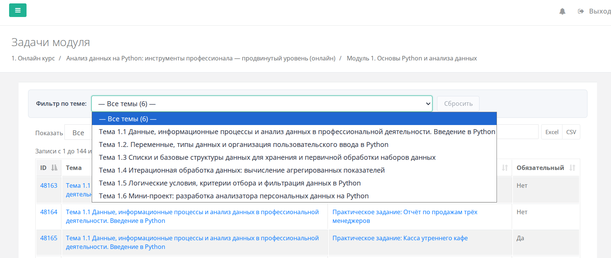
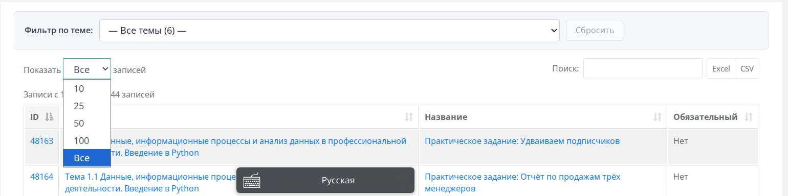

# Расширение для Chrome — Фильтр задач по темам (Платформа МФТИ)

## Описание:

Это расширение добавляет удобные инструменты для работы с таблицей задач на платформе онлайн-курсов МФТИ (edu.mipt.ru). Оно предназначено для страниц со списками практических заданий (URL вида .../online-course/.../.../zadachi/).

## Возможности расширения:

1. Фильтр по темам. Над таблицей появляется панель с выпадающим списком. Расширение автоматически сканирует всю страницу и собирает уникальные названия тем (включая те, которые скрыты на других страницах пагинации). При выборе темы в таблице остаются только относящиеся к ней задания.

2. Показ всех записей. В стандартном выпадающем списке количества строк (где были только 10, 25, 50 и 100) появляется новый пункт «Все». Он позволяет вывести на экран весь список задач сразу, без разбивки на страницы.

3. Корректный экспорт. Кнопки выгрузки в Excel и CSV продолжают работать и выгружают ровно те данные, которые отфильтрованы в данный момент.
4. Сброс. Кнопка «Сбросить» рядом с фильтром возвращает таблицу в исходное состояние, отменяя выбранную тему.

## Инструкция по установке:
1. Скачайте папку с файлами расширения (в ней должно быть три файла: manifest.json, content.js и style.css) и сохраните её в удобное место на компьютере.
2. Откройте браузер Google Chrome.
3. Введите в адресную строку chrome://extensions/ и нажмите Enter.
4. В правом верхнем углу открывшейся страницы включите переключатель «Режим разработчика».
5. В левом верхнем углу нажмите кнопку «Загрузить распакованное расширение».
6. В открывшемся окне выберите папку с вашими файлами. Расширение появится в списке и будет активировано.

## Как пользоваться:
1. Перейдите на страницу с задачами модуля (https://edu.mipt.ru/adm/online-course/*/*/zadachi/).
2. Обновите страницу (F5). Если вы только что установили расширение, это обязательно.
3. Над таблицей появится новая панель «Фильтр по теме:», а в меню «Показать ... записей» появится пункт «Все».

## Примечание:
Для работы расширения требуется Google Chrome версии 111 или выше (используется современный стандарт Manifest V3 с внедрением в основной мир страницы для доступа к скриптам таблицы). Если при обновлении страницы ничего не появилось, откройте консоль разработчика (F12) и проверьте вкладку Console на наличие ошибок.
